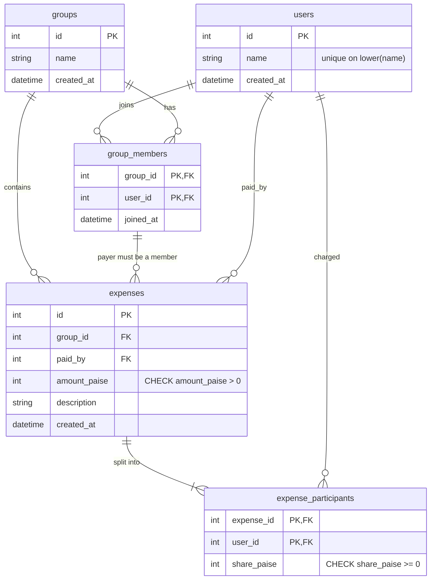

# Expense Sharing Service

A backend service for tracking shared expenses within a group of friends: create users and groups, record expenses that are split equally, view expense history, see who owes whom, and get a short list of suggested payments that would settle the group. Built for the Decentro SDE Intern assignment.

**Stack:** Python 3.12 · FastAPI · SQLAlchemy 2.x · Pydantic v2 · SQLite · pytest + FastAPI TestClient · Docker / Docker Compose · Swagger UI (`/docs`)

**Repository:** https://github.com/prathamesh193/expense-sharing-service

## Contents

1. [Features](#features)
2. [Installation and local setup](#installation-and-local-setup)
3. [Docker setup](#docker-setup)
4. [Configuration](#configuration)
5. [Architecture](#architecture)
6. [Database design](#database-design)
7. [Business rules and assumptions](#business-rules-and-assumptions)
8. [Money handling and balance calculation](#money-handling-and-balance-calculation)
9. [Product enhancement: Smart Settlement Suggestions](#product-enhancement-smart-settlement-suggestions)
10. [API reference](#api-reference)
11. [Sample scenario](#sample-scenario)
12. [Testing](#testing)
13. [Design decisions](#design-decisions)
14. [Limitations and future improvements](#limitations-and-future-improvements)

## Features

Implemented:

- Create and list users (names are unique, case-insensitive)
- Create and list groups
- Add users to a group and list a group's members
- Record an expense (group, payer, amount, description) that is **split equally** among the group's members at that moment
- List a group's expense history, including each participant's stored share
- Calculate balances: who owes whom, plus each person's net position, per group or across all groups
- **Smart Settlement Suggestions**: a read-only endpoint proposing a short list of payments that clears all balances in a group
- Request validation with a consistent JSON error format
- Automated test suite (96 tests)
- Docker and Docker Compose support with a persistent SQLite volume

Not implemented (see [Limitations](#limitations-and-future-improvements)): unequal/custom splits, recording settlements, editing or deleting expenses, removing members, authentication, multiple currencies.

## Installation and local setup

Requires Python 3.12 and Git. Commands are for Windows PowerShell.

```powershell
git clone https://github.com/prathamesh193/expense-sharing-service.git
cd expense-sharing-service

py -3.12 -m venv .venv
.\.venv\Scripts\Activate.ps1      # if blocked: Set-ExecutionPolicy -Scope Process Bypass
pip install -r requirements.txt

uvicorn app.main:app --reload
```

- API: http://localhost:8000
- Swagger UI: http://localhost:8000/docs

**Database initialisation is automatic.** On startup the application creates any missing tables (`app/main.py` lifespan calls `init_db()`), so no separate step is required. The tables can also be created without starting the server with `python -m app.db.init_db`; this is optional. By default the SQLite file `expense_sharing.db` is created in the directory the server is started from.

**Run the tests:**

```powershell
python -m pytest -v
```

## Docker setup

Requires Docker Desktop (the setup was tested with the WSL 2 backend on Windows).

```powershell
docker compose up --build
```

- API: http://localhost:8000
- Swagger UI: http://localhost:8000/docs

Stop the service:

```powershell
docker compose down
```

This stops and removes the container but **keeps** the named volume, so your data survives. Run `docker compose up` again and the records are still there.

```powershell
docker compose down -v
```

This also **deletes the named volume `expense_data` and all persisted database records**. Do not run it unless you intentionally want to wipe the data.

How it is configured (`Dockerfile`, `docker-compose.yml`):

- Image based on `python:3.12-slim`; dependencies installed from `requirements.txt`; only `app/` is copied in.
- The container sets `DATABASE_URL=sqlite:////data/expense_sharing.db` and Compose mounts the named volume `expense_data` at `/data`, so the database file lives outside the container filesystem.
- Port `8000` is published to the host; the server runs `uvicorn app.main:app --host 0.0.0.0 --port 8000`.
- Compose prefixes volume names with the project name, so `docker volume ls` will typically show something like `expense-sharing-service_expense_data`.

Verification status: the author tested this setup on Windows with Docker Desktop (WSL 2): the image builds, the container starts, Swagger UI is reachable, API requests work, and data persists after stopping and restarting the container. The configuration files above were re-read and match these instructions.

## Configuration

| Variable | Purpose | Default |
|---|---|---|
| `DATABASE_URL` | SQLAlchemy database URL | `sqlite:///./expense_sharing.db` |

It is the only setting (`app/core/config.py`). The application reads it **from the process environment only; it does not load a `.env` file**. `.env.example` documents the variable and its default, but copying it to `.env` has no effect on its own. To change the value, set it in the shell before starting the server:

```powershell
$env:DATABASE_URL = "sqlite:///./other.db"
uvicorn app.main:app --reload
```

SQLite is the default and the only database that has been run and tested. `.env.example` also shows a PostgreSQL URL (`postgresql+psycopg://...`, which needs `pip install "psycopg[binary]"`). The schema is written with standard SQLAlchemy constructs, but PostgreSQL support has **not** been tested.

## Architecture

```
expense-sharing-service/
├── app/
│   ├── main.py                  # FastAPI app, router registration, startup table creation, /health
│   ├── api/                     # HTTP layer: parse request -> call service -> return schema
│   │   ├── users.py
│   │   ├── groups.py
│   │   ├── expenses.py
│   │   └── balances.py
│   ├── schemas/                 # Pydantic request/response models and input validation
│   │   ├── user.py  group.py  expense.py  balance.py
│   ├── models/                  # SQLAlchemy tables
│   │   ├── user.py  group.py  expense.py
│   ├── db/                      # Declarative base, engine/session, init_db
│   │   ├── base.py  session.py  init_db.py
│   ├── services/                # Business logic (no HTTP code)
│   │   ├── user_service.py  group_service.py  expense_service.py
│   │   ├── balance_service.py   # DB <-> balance engine glue, builds balance/settlement responses
│   │   ├── balance_engine.py    # Pure integer functions: split, netting, settlement
│   │   └── money.py             # rupees <-> paise conversion and formatting
│   └── core/
│       ├── config.py            # reads DATABASE_URL
│       └── errors.py            # domain exceptions + uniform error responses
├── tests/                       # conftest.py + 6 test modules
├── Dockerfile  docker-compose.yml  .dockerignore
├── requirements.txt  pytest.ini  .env.example  .gitignore
└── README.md
```

**Request flow.** A router in `app/api/` receives the request, FastAPI validates the body against a schema in `app/schemas/`, and the router calls a function in `app/services/` with the database session from `get_db`. The service checks business rules, reads/writes through SQLAlchemy models, and owns the `commit`/`rollback`. For balances, `balance_service` runs one aggregate SQL query and passes plain integers to `balance_engine`, which has no database or HTTP dependencies. The router returns the resulting schema. Expected failures raise exceptions from `app/core/errors.py`, which handlers convert into JSON responses.

`get_db` provides one session per request and always closes it. Tests replace it with a fresh in-memory SQLite database for every test.

## Database design



| Table | Columns | Notes |
|---|---|---|
| `users` | `id`, `name` (≤100), `created_at` | Unique index `uq_users_name_lower` on `lower(name)`. |
| `groups` | `id`, `name` (≤100), `created_at` | Names are not unique. |
| `group_members` | `group_id`, `user_id`, `joined_at` | Composite primary key `(group_id, user_id)` prevents duplicate memberships. FKs: `group_id → groups.id` (`ON DELETE CASCADE`), `user_id → users.id` (`ON DELETE RESTRICT`). Index `ix_group_members_user_id`. |
| `expenses` | `id`, `group_id`, `paid_by`, `amount_paise`, `description` (≤255), `created_at` | `CHECK (amount_paise > 0)`. FK `group_id → groups.id` (`ON DELETE CASCADE`); FK `paid_by → users.id`; **composite FK `(group_id, paid_by) → group_members(group_id, user_id)`** so the payer must be a member of that group. Index `ix_expenses_group_created (group_id, created_at, id)`. |
| `expense_participants` | `expense_id`, `user_id`, `share_paise` | Composite primary key `(expense_id, user_id)`. `CHECK (share_paise >= 0)`. FKs: `expense_id → expenses.id` (`ON DELETE CASCADE`), `user_id → users.id` (`ON DELETE RESTRICT`). Index `ix_expense_participants_user_id`. |

All of the above is defined in the SQLAlchemy models (`app/models/`). The columns are `NOT NULL` unless part of a primary key. SQLite does not enforce foreign keys by default, so `app/db/session.py` runs `PRAGMA foreign_keys=ON` on each SQLite connection; the test suite verifies that the payer-membership FK, the CHECK constraints, the duplicate-membership key, a dangling FK and the unique-name index are enforced by the database.

**How participants are represented.** When an expense is created, the service writes one `expense_participants` row per member of the group *at that moment*, each holding that person's `share_paise`. These rows are never updated. Group membership is a *current* list, whereas the participant rows are a *snapshot*, so adding a member later does not change how earlier expenses were split. The payer also gets a row (their own share) but this is never treated as a debt.

**Trade-offs.**
- Shares are stored rather than recomputed from current membership; this costs a few rows but keeps history correct and makes balances a single aggregate query.
- The rule "participant shares add up to the expense amount" is enforced in the service inside one transaction, not by a database constraint (a CHECK cannot span tables).
- There is no API to delete or edit expenses or remove members, so history is append-only.
- Tables are created with `create_all`; there are no migrations.

## Business rules and assumptions

**Enforced validation (rejected requests):**

| Situation | Behaviour |
|---|---|
| Missing/blank/non-string `name`, or longer than 100 characters | `422 VALIDATION_ERROR`. Names are trimmed. |
| Duplicate user name (case-insensitive) | `409 CONFLICT` |
| Unknown group or user id | `404 NOT_FOUND` |
| Adding a user who is already a member | `409 CONFLICT` (group unchanged) |
| `group_id` in the add-member body differs from the URL | `422 BUSINESS_RULE_VIOLATION` |
| Payer is not a member of the group | `422 BUSINESS_RULE_VIOLATION` |
| `amount` ≤ 0, more than 2 decimals, non-numeric, NaN/Infinity, or more than 12 digits in total | `422 VALIDATION_ERROR` |
| Blank `description` or longer than 255 characters | `422 VALIDATION_ERROR` |
| Ids ≤ 0 or not integers (body, path or query) | `422 VALIDATION_ERROR` |

**Behaviour defined by this implementation (design assumptions):**

- **Empty groups** are valid. They list no members, no expenses and no balances. Recording an expense in one fails because the payer cannot be a member.
- **Participants** of an expense are all members of the group at creation time, including the payer. A group with one member is allowed: the payer is the only participant and no debt is created.
- **Group names** may repeat.
- **Currency** is assumed to be INR; no currency field exists.
- **Expense order:** oldest first (`created_at`, then `id`). Members and users are listed by ascending id.
- **Balance scope:** `GET /balances` without a parameter combines **all groups**; `GET /balances?group_id=N` and `GET /groups/{group_id}/balances` return one group. Settlement suggestions are per group only.
- Expenses are append-only through the API.

## Money handling and balance calculation

**Representation.**
- Money is stored and calculated as **integer paise** (1 rupee = 100 paise). Floating point is not used for money.
- Input `amount` is in **rupees** with at most 2 decimal places, as a JSON number or string (`1200`, `1200.50`, `"10.10"`). It is parsed as `Decimal` and converted exactly to paise. At most 12 digits in total are accepted, so the maximum is 9999999999.99.
- Output money is a **string with exactly two decimals** (`"400.00"`), alongside an integer `*_paise` field. Strings avoid JSON float rounding; this differs from the bare numbers in the assignment's sample payloads.

**Equal split and remainder** (`split_equally`). `base = amount_paise // n`, `remainder = amount_paise % n`. The `remainder` members with the **lowest user ids** receive one extra paisa each. Shares therefore sum exactly to the amount and differ by at most 1 paisa, and the result depends only on the amount and the set of members. Example: ₹100.00 among users 1, 2, 3 → 33.34, 33.33, 33.33. A consequence is that lower ids always receive the extra paisa.

**Balance calculation** (`app/services/balance_engine.py`, fed by `balance_service`):

1. **Raw debts.** One SQL query sums `share_paise` per (participant, payer) pair, **excluding rows where the participant is the payer**, so nobody owes themselves.
2. **Pairwise netting** (`pairwise_balances`). Debts between the same two people are combined and opposite directions are cancelled: if A owes B 700 and B owes A 300, the result is A owes B 400 and nothing in the other direction. Pairs that cancel to zero are dropped. The output is sorted by (debtor, creditor), so it is deterministic. This guarantees only one direction per pair.
3. **Net balances** (`net_balances`). For each debt, the creditor gains and the debtor loses that amount. Positive means "is owed", negative means "owes". The values always sum to exactly zero because each debt adds and subtracts the same integer; users with a net of zero are omitted.

Complexity: the database does the grouping in one query; `pairwise_balances` is O(P log P) for P distinct pairs (dominated by the sort), and `net_balances` is O(P).

The response has three views of the same data: `balances` (explicit debtor/creditor/amount list), `owes` (name-keyed, like the assignment's example) and `net_balances`.

## Product enhancement: Smart Settlement Suggestions

**Endpoint:** `GET /groups/{group_id}/settlements`

**Problem.** After a trip, the pairwise list can be long and indirect: A owes B, B owes C, C owes A... Settling it literally means more transfers than necessary. What a group actually wants to know is: *what is the smallest practical set of payments that makes everyone even?*

**Why it is useful.** Fewer transfers means less friction and fewer chances for mistakes, and the answer can be shown directly to users as a to-do list.

**Algorithm** (`suggest_settlements`):

1. Compute each person's net balance (as above) for the group.
2. Put debtors (net < 0) in one max-heap and creditors (net > 0) in another, ordered by amount, with the lowest user id breaking ties.
3. Repeatedly take the **largest debtor** and the **largest creditor** and create one payment of `min(owed, credit)` from the debtor to the creditor.
4. Push back whoever still has a remainder and repeat until both heaps are empty.

Each step fully clears at least one person, so at most **k − 1** payments are produced, where k is the number of people with a non-zero balance. Time complexity is O(k log k). All arithmetic is integer paise, no zero-value payment is ever produced, and the output is deterministic for the same data. The function raises an error if the net balances do not sum to zero (they always do for real data).

**Design decisions and trade-offs.**
- **Greedy instead of optimal.** Minimising the number of payments exactly is NP-hard (it relates to partitioning balances into zero-sum subsets). The greedy method is simple, fast, explainable and bounded by k − 1, which suits small friend groups. It does **not** guarantee the globally minimum number of payments.
- **Pairwise debts and suggestions are separate concepts.** `/balances` shows the real underlying "who owes whom"; `/settlements` is a *plan*. A suggestion may ask A to pay C directly even though A's actual debts were to B. Both views are kept so neither hides the other.
- **Read-only by design.** The endpoint only reads data. It does not record payments or change any balance, because a suggestion is not proof that a payment happened. Recording settlements would need its own table and rules (partial payments, confirmation, reversal), which is outside this implementation.
- **Per group.** Suggestions are computed within one group so unrelated groups' debts are not mixed.

**Limitations.** Not guaranteed minimal; does not consider preferences (who would rather pay whom) or payment-method constraints; payments are not tracked, so calling the endpoint again returns the same suggestion until new expenses change the balances.

## API reference

Interactive documentation: http://localhost:8000/docs

| Method | Path | Purpose | Required fields | Success |
|---|---|---|---|---|
| `POST` | `/users` | Create a user | body `name` | `201` `{id, name}` |
| `GET` | `/users` | List users (by id) | none | `200` list |
| `POST` | `/groups` | Create a group | body `name` | `201` `{id, name}` |
| `GET` | `/groups` | List groups (by id) | none | `200` list |
| `POST` | `/groups/{group_id}/members` | Add a user to a group | body `user_id` (`group_id` optional, must match URL) | `201` `{id, name, joined_at}` |
| `GET` | `/groups/{group_id}/members` | List a group's members (by user id) | none | `200` list of `{id, name, joined_at}` |
| `POST` | `/expenses` | Record an expense, split equally | body `group_id`, `paid_by`, `amount`, `description` | `201` expense object |
| `GET` | `/groups/{group_id}/expenses` | Expense history (oldest first) | none | `200` list of expense objects |
| `GET` | `/balances` | Balances across all groups, or one group with `?group_id=N` | none | `200` balances object |
| `GET` | `/groups/{group_id}/balances` | Balances for one group | none | `200` balances object |
| `GET` | `/groups/{group_id}/settlements` | Smart settlement suggestions | none | `200` settlements object |
| `GET` | `/health` | Liveness check | none | `200` `{"status": "ok"}` |

**Errors.** Validation failures, `404`, `409` and rule violations return:

```json
{ "error": { "code": "NOT_FOUND", "message": "Group 99 not found" } }
```

Codes: `VALIDATION_ERROR` (422, includes a `details` list of `{field, message}`, e.g. `amount`, `path.group_id`, `query.group_id`), `NOT_FOUND` (404), `CONFLICT` (409), `BUSINESS_RULE_VIOLATION` (422). Errors raised by the framework itself (an unknown URL, or a wrong HTTP method on an existing URL) use FastAPI's default `{"detail": "..."}` format with `404` / `405`.

Specific error cases:

| Endpoint | Errors |
|---|---|
| `POST /users` | `422` invalid name; `409` duplicate name |
| `POST /groups` | `422` invalid name |
| `POST /groups/{id}/members` | `404` unknown group or user; `409` already a member; `422` invalid `user_id`, or body `group_id` ≠ URL |
| `GET /groups/{id}/members`, `/expenses`, `/balances`, `/settlements` | `404` unknown group |
| `POST /expenses` | `422` invalid amount/description/ids; `404` unknown group or payer; `422` payer not in group |
| `GET /balances` | `404` unknown `group_id`; `422` `group_id` ≤ 0 or not an integer |

### Examples

The examples use the users and group from the [sample scenario](#sample-scenario). Timestamps are illustrative.

**Create a user** — `POST /users`
```json
{ "name": "Mohit" }
```
```json
{ "id": 1, "name": "Mohit" }
```

**Create a group** — `POST /groups`
```json
{ "name": "Goa Trip" }
```
```json
{ "id": 1, "name": "Goa Trip" }
```

**Add a member** — `POST /groups/1/members`
```json
{ "user_id": 1 }
```
```json
{ "id": 1, "name": "Mohit", "joined_at": "2026-10-13T12:43:42.725700Z" }
```

**Record an expense** — `POST /expenses`
```json
{ "group_id": 1, "paid_by": 1, "amount": 1200, "description": "Dinner" }
```
```json
{
  "id": 1,
  "group_id": 1,
  "description": "Dinner",
  "amount": "1200.00",
  "amount_paise": 120000,
  "paid_by": "Mohit",
  "paid_by_id": 1,
  "created_at": "2026-10-13T12:43:42.780000Z",
  "participants": [
    { "user_id": 1, "name": "Mohit", "share": "400.00", "share_paise": 40000 },
    { "user_id": 2, "name": "Rahul", "share": "400.00", "share_paise": 40000 },
    { "user_id": 3, "name": "Ankit", "share": "400.00", "share_paise": 40000 }
  ]
}
```
In the request `paid_by` is the payer's user id. In the response `paid_by` is the payer's **name** (matching the assignment's example response) and `paid_by_id` is the id.

**List expenses** — `GET /groups/1/expenses` returns an array of the objects above, oldest first.

**Balances** — `GET /balances?group_id=1` after the dinner only:
```json
{
  "scope": { "type": "group", "group_id": 1 },
  "currency": "INR",
  "balances": [
    { "debtor": { "id": 2, "name": "Rahul" }, "creditor": { "id": 1, "name": "Mohit" }, "amount": "400.00", "amount_paise": 40000 },
    { "debtor": { "id": 3, "name": "Ankit" }, "creditor": { "id": 1, "name": "Mohit" }, "amount": "400.00", "amount_paise": 40000 }
  ],
  "owes": {
    "Rahul": { "owes": { "Mohit": "400.00" } },
    "Ankit": { "owes": { "Mohit": "400.00" } }
  },
  "net_balances": [
    { "user": { "id": 1, "name": "Mohit" }, "net": "800.00", "net_paise": 80000 },
    { "user": { "id": 2, "name": "Rahul" }, "net": "-400.00", "net_paise": -40000 },
    { "user": { "id": 3, "name": "Ankit" }, "net": "-400.00", "net_paise": -40000 }
  ]
}
```
Without `group_id`, `scope` is `{ "type": "all_groups", "group_id": null }`.

**Settlement suggestions** — `GET /groups/1/settlements` (after both expenses of the sample scenario):
```json
{
  "group_id": 1,
  "currency": "INR",
  "is_settled": false,
  "payment_count": 2,
  "suggested_payments": [
    { "from_user": { "id": 3, "name": "Ankit" }, "to_user": { "id": 1, "name": "Mohit" }, "amount": "433.33", "amount_paise": 43333 },
    { "from_user": { "id": 2, "name": "Rahul" }, "to_user": { "id": 1, "name": "Mohit" }, "amount": "333.33", "amount_paise": 33333 }
  ],
  "note": "Suggestions only. Recording or following them does not change any balance."
}
```
When nothing is owed, `is_settled` is `true`, `payment_count` is `0` and `suggested_payments` is `[]`.

**Validation error** — `POST /expenses` with `"amount": -5`:
```json
{
  "error": {
    "code": "VALIDATION_ERROR",
    "message": "Request validation failed",
    "details": [ { "field": "amount", "message": "Input should be greater than 0" } ]
  }
}
```

## Sample scenario

Users Mohit (id 1), Rahul (id 2) and Ankit (id 3) are all members of the group "Goa Trip".

1. Mohit pays **₹1,200** for "Dinner". Equal split: 1200.00 ÷ 3 = 400.00 each.
2. Rahul pays **₹100** for "Taxi". 100.00 ÷ 3 = 33.33 remainder 1 paisa: 10000 paise = 3333 × 3 + 1, so the lowest id (Mohit) gets the extra paisa → Mohit **33.34**, Rahul **33.33**, Ankit **33.33** (total 100.00).

| Debt | Calculation | Result |
|---|---|---|
| Rahul → Mohit | owes 400.00 for dinner; Mohit owes Rahul 33.34 for the taxi, so the two cancel | **366.66** |
| Ankit → Mohit | dinner share | **400.00** |
| Ankit → Rahul | taxi share | **33.33** |

Net positions: Mohit +400.00 + 400.00 − 33.34 = **+766.66**; Rahul −400.00 + 66.67 (taxi, paid 100.00 and own share 33.33) = **−333.33**; Ankit −400.00 − 33.33 = **−433.33**. They sum to 0.00.

Settlement suggestion: Ankit → Mohit **433.33** and Rahul → Mohit **333.33** (two payments instead of three pairwise debts).

**Verification:** this exact sequence of requests (create three users and the group, add the three members, post the dinner, post the taxi, then read `/balances?group_id=1` and `/groups/1/settlements`) was run against a locally started server with a fresh SQLite database on 2026-10-13 and returned exactly the figures above.

## Testing

```powershell
python -m pytest -v
```

**Result:** 96 passed. This was re-run against a fresh clone of the repository (Python 3.12, SQLite) while preparing this README. No coverage report has been produced, so no coverage percentage is claimed.

Every test uses its own in-memory SQLite database (`tests/conftest.py`), so tests do not depend on each other, on execution order or on a local database file.

| Test file | Tests | Covers |
|---|---|---|
| `tests/test_users_groups.py` | 24 | User and group creation and listing; duplicate and invalid names; malformed JSON; adding members; duplicate membership; unknown users/groups; empty groups; body `group_id` mismatch |
| `tests/test_expenses.py` | 27 | Equal split with exact amounts; remainder paise; decimal amounts (`10.10`, `0.30`); amount ≤ 0, too many decimals, NaN/Infinity, non-numeric; missing fields; unknown group/payer; payer not a member; single-member group; history order and contents; late members not altering historical splits |
| `tests/test_balances.py` | 12 | Assignment example; payer never owes themselves; multiple payers; cancelling debts; fully settled groups; remainder paise never lost; zero-sum net balances; system-wide vs per-group scope; unknown group |
| `tests/test_settlements.py` | 5 | Assignment example; fewer payments than pairwise debts; suggestions clear every net balance; read-only and deterministic; nothing to settle; unknown group |
| `tests/test_balance_engine.py` | 20 | Pure-function tests for splitting, netting, settlement and money formatting, including seeded randomised property checks (shares sum exactly, net balances sum to zero, settlements clear all balances) |
| `tests/test_transactions_and_constraints.py` | 8 | Rollback when expense creation fails midway (no orphan rows); successful commit; database-level rejection of a non-member payer, non-positive amount, duplicate membership, dangling foreign key and case-insensitive duplicate names; no edit/delete routes for expenses |

## Design decisions

- **FastAPI:** request validation and typed schemas come from Pydantic, and Swagger UI is generated automatically from the same models, so the API documentation cannot drift from the code.
- **Schema with a participant snapshot:** keeps historical splits stable when membership changes, and turns balance calculation into one aggregate query (see [Database design](#database-design)).
- **Constraints in the database:** the payer-membership foreign key, the CHECK constraints and the unique keys protect integrity even if application code has a bug.
- **Integer paise:** binary floating point cannot represent most decimal amounts exactly; integers make sums exact, so shares always add up to the expense amount and balances always sum to zero.
- **Business logic separate from routes:** routers only translate HTTP to function calls, so rules live in one place, and the balance engine can be unit-tested with plain integers.
- **Transactions in services:** an expense and all its participant rows are committed together or not at all.
- **Read-only settlement suggestions:** see the [enhancement section](#product-enhancement-smart-settlement-suggestions).

## Limitations and future improvements

**Current limitations:**
- Equal splits only; no custom amounts.
- Settlements cannot be recorded; suggestions are read-only and greedy (not guaranteed minimal).
- No editing or deleting of expenses, and no removing members.
- No authentication or pagination.
- Single currency (INR assumed).
- Remainder paise always go to the lowest user ids.
- Tables are created by `create_all`; there are no database migrations.
- Only SQLite has been run and tested; PostgreSQL support is untested.

**Possible future improvements (not implemented):**
- Custom/unequal splits; the existing `expense_participants` table already stores one share per person.
- Recording settlements in a separate table and including them in the netting step.
- Alembic migrations and PostgreSQL testing.
- Pagination for lists and history.
- Authentication and per-group authorisation.
- Expense categories, search or monthly summaries.
